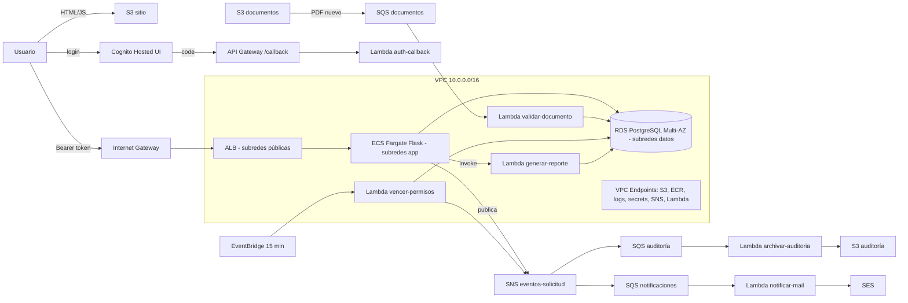

# AccesoSeguro — Infraestructura como Código (TP3)

82.08 Cloud Computing · Terraform sobre AWS Learner Lab

Este repositorio levanta con Terraform la arquitectura de **AccesoSeguro** (versión del
17/10/2026, con la devolución de la cátedra del 16/10): sitio estático en S3, login con la
Hosted UI de Cognito, API Flask en ECS Fargate detrás de un ALB, RDS PostgreSQL Multi-AZ,
6 Lambdas, SNS + SQS con DLQ, EventBridge y SES. Sin EC2 y sin NAT Gateway.

---

## 1. Por qué hay dos proyectos de Terraform

Terraform guarda en el **state file** (`terraform.tfstate`) qué recursos creó y con qué ID.
Si ese archivo queda en la máquina de una sola persona, el resto del equipo (y el pipeline)
no puede trabajar. Por eso el state va a un **backend remoto en S3**.

El problema: el bucket del state tiene que existir antes de que el Terraform principal pueda
usarlo. Como vimos en clase, se resuelve con **dos Terraform**:

| Proyecto | Qué crea | Dónde guarda su propio state |
|---|---|---|
| `bootstrap/` | El bucket S3 del state (versionado, cifrado, privado, solo HTTPS, `prevent_destroy`) y genera `infra/backend.hcl` | Local (`bootstrap/terraform.tfstate`) |
| `infra/` | Toda la arquitectura de AccesoSeguro | En el bucket creado por `bootstrap/` |

El nombre del bucket es una variable (no está hardcodeado) y por defecto se arma como
`accesoseguro-tfstate-<account_id>` para que sea único a nivel global.

**Lock del state.** Con Terraform ≥ 1.10 el backend S3 bloquea el state con un archivo `.tflock`
en el mismo bucket (`use_lockfile = true`): si dos personas hacen `apply` a la vez, la segunda
espera. La tabla DynamoDB del método clásico queda como opción (`create_dynamodb_lock_table`).

---

## 2. Estructura del repositorio

```
.
├── .github/workflows/terraform.yml   # Pipeline: fmt, init, validate y plan en cada PR
├── terraform/
│   ├── bootstrap/                    # 1er Terraform: bucket del state (+ genera infra/backend.hcl)
│   ├── infra/                        # 2do Terraform: la arquitectura, un archivo por capa
│   │   ├── versions.tf  variables.tf  locals.tf  data.tf  outputs.tf
│   │   ├── network.tf  security.tf  frontend.tf  storage.tf  identity.tf
│   │   ├── alb.tf  ecs.tf  database.tf  lambdas.tf  messaging.tf  monitoring.tf
│   │   └── backend.hcl.example  terraform.tfvars.example
│   └── modules/                      # Módulos propios
│       ├── network/                  # VPC, subredes, IGW, rutas y NACL
│       ├── lambda-function/          # Lambda + zip + log group
│       └── sqs-with-dlq/             # cola + DLQ + alarma
├── lambdas/<nombre>/handler.py       # código de las 6 Lambdas
├── app/                              # API Flask + Dockerfile (imagen de ECS)
├── frontend/                         # sitio estático + config.js.tftpl
├── scripts/push-image.sh             # build + push a ECR + redeploy de ECS
├── Makefile                          # atajos: make bootstrap / init / plan / apply / image
├── architecture.png                  # diagrama actualizado
└── README.md
```

Convenciones: todos los recursos se llaman `<proyecto>-<ambiente>-<componente>`
(ej. `accesoseguro-dev-cola-auditoria`); los nombres locales de Terraform van en
`snake_case`; los recursos únicos de un módulo se llaman `this`.

---

## 3. De la arquitectura al código



| Capa (PDF) | Servicio | Archivo | Recursos principales |
|---|---|---|---|
| Front | S3 sitio estático | `frontend.tf` | `aws_s3_bucket.sitio`, website, policy pública de lectura, `aws_s3_object` |
| Identidad | Cognito + API Gateway /callback + Lambda | `identity.tf` | User Pool, 3 grupos, dominio, app client, HTTP API |
| Entrada | Internet Gateway + ALB | `modules/network`, `alb.tf` | IGW, `aws_lb`, target group tipo `ip`, listener 80 |
| Cómputo | ECS Fargate, ECR, 6 Lambdas | `ecs.tf`, `lambdas.tf` | cluster, task definition, service, autoscaling, `module.lambdas` |
| Datos | RDS Multi-AZ, 2 buckets privados | `database.tf`, `storage.tf` | `aws_db_instance.main`, `module.buckets` |
| Eventos | SNS, SQS + DLQ, EventBridge, SES | `messaging.tf`, `lambdas.tf` | tópico, `module.sqs`, suscripciones, regla cada 15 min |
| Seguridad | VPC, SG, NACL, Secrets Manager, KMS, LabRole, CloudTrail | `network.tf`, `security.tf` | SG encadenados, NACL datos, clave KMS, secretos |
| Operación | CloudWatch, Auto Scaling | `monitoring.tf`, `ecs.tf` | alarmas (5xx, tasks sanas, DLQ, errores Lambda, RDS) |

### Red
| Subred | CIDR | Contiene | Ruta a internet |
|---|---|---|---|
| publica-a / publica-b | 10.0.1.0/24 y 10.0.2.0/24 | ALB | Sí (IGW) |
| app-a / app-b | 10.0.11.0/24 y 10.0.12.0/24 | Tasks de ECS, Lambdas en la VPC, endpoints | No |
| datos-a / datos-b | 10.0.21.0/24 y 10.0.22.0/24 | RDS primaria y standby | No |

Security Groups encadenados: `alb` (80 desde internet) → `ecs` (5000 solo desde `alb`) →
`rds` (5432 solo desde `ecs` y `lambda`); `endpoints` (443 desde `ecs` y `lambda`).

---

## 4. Módulos

| Módulo | Tipo | Para qué | Cómo se usa |
|---|---|---|---|
| `modules/network` | **Propio** | VPC en 3 capas x 2 AZ, IGW, tablas de ruteo y NACL | Una vez, en `network.tf` |
| `modules/lambda-function` | **Propio** | Empaquetar y crear una Lambda con su log group | Una llamada con `for_each` crea las 6 |
| `modules/sqs-with-dlq` | **Propio** | Cola + DLQ + alarma | Una llamada con `for_each` crea las 3 colas |
| `terraform-aws-modules/s3-bucket/aws` `~> 5.0` | **Externo** (Terraform Registry) | Buckets privados con cifrado KMS, versionado, lifecycle, CORS y política "solo HTTPS" | Una llamada con `for_each` crea documentos y auditoría |

Cada módulo propio sigue la estructura recomendada en clase: `main.tf`, `variables.tf`,
`outputs.tf`, `versions.tf` y `README.md`.

---

## 5. Funciones de Terraform utilizadas

| Función | Dónde | Para qué |
|---|---|---|
| `cidrsubnet()` | `modules/network/main.tf` | Calcular el CIDR de cada subred a partir de la VPC |
| `cidrhost()` + `can()` | `modules/network/variables.tf` | Validar que `vpc_cidr` sea un CIDR válido |
| `merge()` | network, `locals.tf` | Unir los mapas de subredes por capa; unir nombres de buckets |
| `substr()` | network, `alb.tf` | Letra de la AZ (`us-east-1a` → `a`); recortar nombres a 32 caracteres |
| `slice()` | `locals.tf` | Quedarse con las primeras N zonas de disponibilidad |
| `format()` | `locals.tf`, `security.tf`, `bootstrap/main.tf` | Armar nombres de bucket, dominio de Cognito y URLs |
| `coalesce()` | `bootstrap/main.tf` | Usar el nombre de bucket pasado o, si está vacío, uno generado |
| `templatefile()` | `bootstrap/main.tf`, `frontend.tf` | Generar `backend.hcl` y el `config.js` del sitio con valores reales |
| `jsonencode()` | KMS, bucket policies, SQS, ECS, ECR | Escribir políticas y definiciones JSON en HCL |
| `fileset()` + `setsubtract()` | `locals.tf` | Listar los archivos del sitio para subirlos (sin la plantilla) |
| `filemd5()` | `frontend.tf` | Volver a subir un archivo solo si cambió |
| `lookup()`, `split()`, `element()`, `length()`, `lower()` | `frontend.tf` | Elegir el Content-Type según la extensión |
| `urlencode()`, `join()` | `locals.tf` | Armar la URL de login de la Hosted UI |
| `keys()`, `sort()` | `ecs.tf` | Pasar el mapa de variables de entorno al formato de ECS |
| `toset()`, `compact()`, `concat()` | `messaging.tf`, `network.tf` | Lista de mails a verificar sin vacíos; set para `for_each` |
| `tostring()` | `locals.tf` | Las variables de entorno tienen que ser strings |
| `title()`, `replace()` | `messaging.tf`, `network.tf` | Armar el `Sid` de la policy y el nombre de cada endpoint |
| `max()` | `ecs.tf` | El máximo del Auto Scaling nunca queda por debajo del mínimo |
| `formatdate()`, `timestamp()` | `database.tf` | Nombre del snapshot final en prod |
| `one()` | `bootstrap/outputs.tf` | Output de un recurso creado con `count` (o `null`) |
| `contains()`, `regex()` | `variables.tf` | Validaciones de entrada |

---

## 6. Meta-argumentos utilizados

| Meta-argumento | Dónde | Por qué |
|---|---|---|
| `for_each` | Subredes, rutas, SG y sus reglas, endpoints, grupos de Cognito, `module.lambdas`, `module.sqs`, `module.buckets`, event source mappings, suscripciones SNS, alarmas | Crear N recursos parecidos a partir de un mapa, con claves estables (`publica-a`, `cola-auditoria`) |
| `count` | IGW (si hay capa pública), CloudTrail (`enable_cloudtrail`), suscripción de alarmas por mail, tabla DynamoDB de locks, `local_file` del backend | Recursos opcionales: 0 o 1 según una variable |
| `depends_on` | Policy del bucket después del public access block; notificación S3 después de la policy de la cola; suscripción SNS después de la policy; servicio ECS después del listener y de los endpoints; CloudTrail después de la policy del bucket; log group antes de la Lambda | Dependencias que AWS exige pero que Terraform no puede deducir de las referencias |
| `lifecycle { prevent_destroy }` | Bucket del state (`bootstrap/`) | Que un `destroy` nunca borre el state |
| `lifecycle { create_before_destroy }` | Security Groups, parameter group de RDS | Reemplazar sin cortar: AWS no deja borrar un SG en uso |
| `lifecycle { ignore_changes }` | `desired_count` del servicio ECS; `schema` del User Pool; snapshot final de RDS | No pelear con el Auto Scaling; Cognito no permite modificar el schema (recrearía el pool y se perderían los usuarios) |

También se usan **bloques `dynamic`** (`vpc_config` de las Lambdas, reglas de la NACL) y
**validaciones** en las variables.

---

## 7. Paso a paso

Atajo: todos los pasos están en el `Makefile` (`make help`).

### Requisitos
- Terraform ≥ 1.10 (`terraform -version`)
- AWS CLI v2 y Docker
- Credenciales del Learner Lab: **AWS Details → AWS CLI** y pegarlas en `~/.aws/credentials`
  (vencen cada sesión de 4 horas)

```bash
aws sts get-caller-identity   # tiene que mostrar el account id del lab
```

### Paso 1 — State remoto (bootstrap)
```bash
cd terraform/bootstrap
cp terraform.tfvars.example terraform.tfvars   # opcional
terraform init
terraform plan
terraform apply
terraform output
```
Esto crea el bucket `accesoseguro-tfstate-<account_id>` y escribe `infra/backend.hcl`.
**Guardar `bootstrap/terraform.tfstate`** (no se sube al repo). Si se pierde, el bucket se
puede importar con `terraform import aws_s3_bucket.tfstate <nombre>`.

### Paso 2 — Infraestructura
```bash
cd ../infra
cp terraform.tfvars.example terraform.tfvars   # completar los mails de SES
terraform init -backend-config=backend.hcl
terraform validate
terraform plan -out=tfplan
terraform apply tfplan                          # ~15-20 min (RDS Multi-AZ es lo más lento)
```
Para verificar que el state quedó en S3:
```bash
aws s3 ls s3://$(cd ../bootstrap && terraform output -raw state_bucket_name)/accesoseguro/dev/
```

### Paso 3 — Imagen de la API
El servicio de ECS queda creado pero las tasks no arrancan hasta que exista la imagen
`v1.0` en ECR. Los comandos exactos los da Terraform:
```bash
terraform output -raw docker_push_commands
```
(login a ECR → `docker build` → `docker push` → `aws ecs update-service --force-new-deployment`).
Para desplegar una versión nueva: subir `v1.1`, cambiar `api_image_tag` y `terraform apply`
(nueva revisión de la task definition + rolling update).

### Paso 4 — Probar
```bash
terraform output sitio_url      # abrir en el navegador → "Ingresar"
terraform output api_url        # curl <api_url>/health  → {"status":"ok"}
```
- Confirmar los mails de verificación que manda SES (sandbox).
- Crear usuarios de prueba y asignar grupo / empresa:
```bash
POOL=$(terraform output -raw cognito_user_pool_id)
aws cognito-idp admin-add-user-to-group --user-pool-id $POOL --username <mail> --group-name responsables_sede
aws cognito-idp admin-update-user-attributes --user-pool-id $POOL --username <mail> \
  --user-attributes Name=custom:empresa_id,Value=EMP-001
```
- Probar el flujo asincrónico: subir un PDF a `s3://<bucket documentos>/empresas/EMP-001/...`
  y ver los logs de `validar-documento` en CloudWatch.

### Paso 5 — Destruir (al terminar la sesión del lab)
```bash
cd terraform/infra && terraform destroy
```
El bucket del state **no** se destruye (tiene `prevent_destroy`). Si de verdad hay que borrarlo,
sacar el bloque `lifecycle` de `bootstrap/main.tf`, vaciar el bucket y hacer `terraform destroy`.

---

## 8. Pipeline de GitHub Actions

`.github/workflows/terraform.yml` corre en cada **pull request** a `main`:

| Job | Pasos | Necesita credenciales |
|---|---|---|
| `validate` (matriz `bootstrap` / `infra`) | `terraform fmt -check` → `terraform init -backend=false` → `terraform validate` | No |
| `plan` (`infra`) | arma `backend.hcl` → `terraform init` → `terraform plan` → publica el plan en el resumen y comenta en el PR | Sí |

Secrets a cargar en **Settings → Secrets and variables → Actions** del repositorio donde
corre el PR:

| Secret | Valor |
|---|---|
| `AWS_ACCESS_KEY_ID` | del Learner Lab |
| `AWS_SECRET_ACCESS_KEY` | del Learner Lab |
| `AWS_SESSION_TOKEN` | del Learner Lab (vence: actualizarlo antes de abrir el PR) |
| `TF_STATE_BUCKET` | salida `state_bucket_name` de `bootstrap/` |

Si faltan los secrets, el job `plan` muestra un aviso y termina sin error; `validate` corre
igual. **Antes de cada push** correr `make fmt` para que no falle
el `fmt -check`.

---

## 9. Decisiones por las restricciones del Learner Lab

| Restricción | Cómo se resolvió |
|---|---|
| No se pueden crear roles IAM | ECS y Lambdas usan `LabRole` (`data.aws_iam_role.lab_role`). Sí se escriben políticas sobre los recursos (buckets, colas, KMS) |
| No hay CloudFront ni HTTPS en el sitio | Cognito vuelve a API Gateway `/callback` (HTTPS) y la Lambda redirige al sitio con los tokens en el `#` |
| Las tasks no tienen salida a internet | VPC Endpoints. Las llaves públicas de Cognito (JWKS) las lee Terraform (`data.http`) y se pasan al contenedor como variable de entorno |
| SES en sandbox | Se verifican el remitente y los destinatarios de prueba (`ses_verified_emails`) |
| CloudTrail | El historial de 90 días existe siempre; el trail propio queda detrás de `enable_cloudtrail` |
| Se destruye y recrea seguido | `force_destroy` en buckets, `recovery_window_in_days = 0` en secretos, `skip_final_snapshot` fuera de prod |

## 10. Qué es placeholder

- `app/`: Flask mínimo con `/health` y `/api/info` para que el despliegue funcione de punta
  a punta. Reemplazar por la API real.
- `frontend/`: una página de prueba (login y llamada a la API). Reemplazar por el sitio real;
  `config.js` lo sigue generando Terraform.
- Lambdas `validar-documento`, `vencer-permisos` y `generar-reporte`: la parte de RDS está
  simulada (mock data, permitido por la consigna). Para conectarse de verdad hace falta un
  driver de PostgreSQL en una Lambda Layer.
