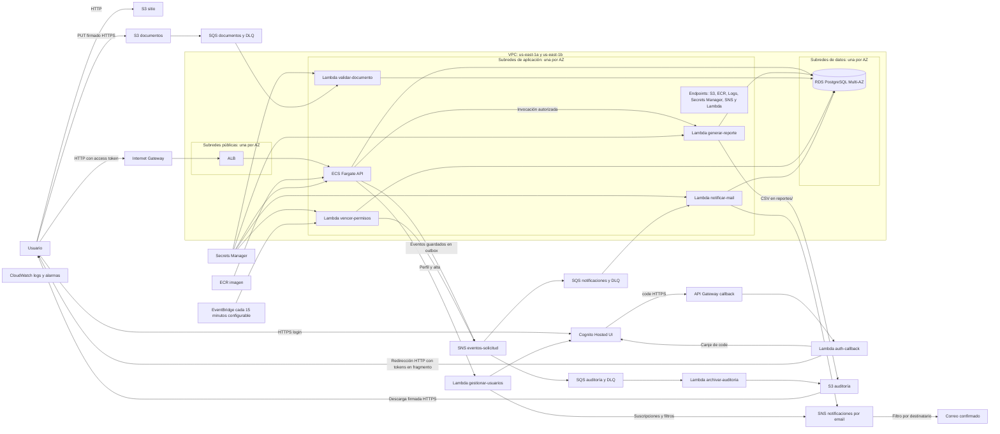

# AccesoSeguro — Infraestructura como Código (TP3)

82.08 Cloud Computing · Terraform sobre AWS Learner Lab

Este repositorio levanta con Terraform la arquitectura de **AccesoSeguro** : sitio estático en S3, login con la
Hosted UI de Cognito, API Flask en ECS Fargate detrás de un ALB, RDS PostgreSQL Multi-AZ,
7 Lambdas, SNS + SQS con DLQ y EventBridge; los avisos por mail salen por SNS. Sin EC2 y sin NAT Gateway.

La red se despliega exclusivamente en **us-east-1a y us-east-1b**, con una subred por capa en cada zona.

---

## 1. Por qué hay dos proyectos de Terraform

Terraform guarda en el **state file** (`terraform.tfstate`) qué recursos creó y con qué ID.
Si ese archivo queda en la máquina de una sola persona, el resto del equipo (y el pipeline)
no puede trabajar. Por eso el state va a un **backend remoto en S3**.

El problema: el bucket del state tiene que existir antes de que el Terraform principal pueda
usarlo. Como vimos en clase, se resuelve con **dos Terraform**:

| Proyecto | Qué crea | Dónde guarda su propio state |
|---|---|---|
| `bootstrap/` | El bucket S3 del state (versionado, cifrado, privado, solo HTTPS, `prevent_destroy`) y genera `infra/backend.hcl` | Temporal local; el despliegue lo migra al mismo S3, con lock |
| `infra/` | Toda la arquitectura de AccesoSeguro | En el bucket creado por `bootstrap/` |

El nombre del bucket es una variable (no está hardcodeado) y por defecto se arma como
`accesoseguro-tfstate-<account_id>` para que sea único a nivel global.

**Lock del state.** Con Terraform ≥ 1.10 el backend S3 bloquea el state con un archivo `.tflock`
en el mismo bucket (`use_lockfile = true`): si dos personas hacen `apply` a la vez, la segunda
espera. La tabla DynamoDB del método clásico queda como opción (`create_dynamodb_lock_table`).

---

## 2. Estructura del repositorio

```
.
├── .github/workflows/terraform.yml   # fmt, init, validate y plan en cada PR
├── .github/workflows/deploy.yml      # despliegue completo manual, incluidas imagen y RDS
├── terraform/
│   ├── bootstrap/                    # 1er Terraform: bucket del state (+ genera infra/backend.hcl)
│   ├── infra/                        # 2do Terraform: la arquitectura, un archivo por capa
│   │   ├── versions.tf  variables.tf  locals.tf  data.tf  outputs.tf
│   │   ├── network.tf  security.tf  frontend.tf  storage.tf  identity.tf
│   │   ├── alb.tf  ecs.tf  database.tf  lambdas.tf  messaging.tf  monitoring.tf
│   │   └── backend.hcl.example  terraform.tfvars.example
│   └── modules/                      # Módulos propios
│       ├── network/                  # VPC, subredes, IGW, rutas y NACL
│       ├── lambda-function/          # Lambda + zip + log group
│       ├── sqs-with-dlq/             # cola + DLQ + alarma
│       └── s3-bucket/                # bucket compatible con el Learner Lab
├── lambdas/<nombre>/handler.py       # código de las 7 Lambdas
├── backend/                          # API Flask + Dockerfile (imagen de ECS)
├── frontend/                         # sitio estático (HTML/CSS/JS) + config.js.tftpl
├── scripts/deploy.py                 # ordena infraestructura, imagen, base y verificaciones
├── Makefile                          # atajos: make bootstrap / init / plan / apply / image
├── docs/arquitectura.mmd             # fuente del diagrama actualizado
└── README.md
```

Convenciones: todos los recursos se llaman `<proyecto>-<ambiente>-<componente>`
(ej. `accesoseguro-dev-cola-auditoria`); los nombres locales de Terraform van en
`snake_case`; los recursos únicos de un módulo se llaman `this`.

---

## 3. De la arquitectura al código



| Capa (PDF) | Servicio | Archivo | Recursos principales |
|---|---|---|---|
| Front | S3 sitio estático | `frontend.tf` | `aws_s3_bucket.sitio`, website, policy pública de lectura, `aws_s3_object` |
| Identidad | Cognito + API Gateway /callback + Lambda | `identity.tf` | User Pool, 3 roles (transportistas, porteros y responsables_sede), dominio, app client, HTTP API |
| Entrada | Internet Gateway + ALB | `modules/network`, `alb.tf` | IGW, `aws_lb`, target group tipo `ip`, listener 80 |
| Cómputo | ECS Fargate, ECR, 7 Lambdas | `ecs.tf`, `lambdas.tf` | cluster, task definition, service, autoscaling, `module.lambdas` |
| Datos | RDS Multi-AZ, 2 buckets privados | `database.tf`, `storage.tf` | `aws_db_instance.main`, `module.buckets` |
| Eventos | SNS, SQS + DLQ, EventBridge, SNS por mail | `messaging.tf`, `lambdas.tf` | tópico, `module.sqs`, suscripciones, DLQs de entrega, recuperación cada 15 minutos (configurable) |
| Seguridad | VPC, SG, NACL, Secrets Manager, KMS, LabRole, CloudTrail | `network.tf`, `security.tf` | SG encadenados, NACL datos, clave KMS, secretos |
| Operación | CloudWatch, Auto Scaling | `monitoring.tf`, `ecs.tf` | alarmas (5xx, tasks sanas, DLQ, errores Lambda, RDS) |

### Red
| Subred | CIDR | Contiene | Ruta a internet |
|---|---|---|---|
| publica-a / publica-b | 10.0.1.0/24 y 10.0.2.0/24 | ALB | Sí (IGW) |
| app-a / app-b | 10.0.11.0/24 y 10.0.12.0/24 | Tasks de ECS, Lambdas en la VPC, endpoints | No |
| datos-a / datos-b | 10.0.21.0/24 y 10.0.22.0/24 | RDS primaria y standby | No |

Security Groups encadenados: `alb` (80 desde internet) → `ecs` (5000 solo desde `alb`) →
`rds` (5432 solo desde `ecs` y `lambda`); `endpoints` (443 desde `ecs` y `lambda`).

---

## 4. Módulos

| Módulo | Tipo | Para qué | Cómo se usa |
|---|---|---|---|
| `modules/network` | **Propio** | VPC en 3 capas x 2 AZ, IGW, tablas de ruteo y NACL | Una vez, en `network.tf` |
| `modules/lambda-function` | **Propio** | Empaquetar y crear una Lambda con su log group | Una llamada con `for_each` crea las 7 |
| `modules/sqs-with-dlq` | **Propio** | Cola + DLQ + alarma | Una llamada con `for_each` crea las 3 colas |
| `modules/s3-bucket` | **Propio** | Bucket con cifrado, versionado, políticas, lifecycle, CORS y website, compatible con el Learner Lab | `for_each` (documentos y auditoría), una vez para el sitio y con `count` para CloudTrail |
| `terraform-aws-modules/ecr/aws` `~> 2.0` | **Externo** (Terraform Registry) | Repositorio ECR con tags inmutables, escaneo, cifrado KMS y lifecycle policy | Una vez, en `ecs.tf` |

Cada módulo propio sigue la estructura recomendada en clase: `main.tf`, `variables.tf`,
`outputs.tf`, `versions.tf` y `README.md`.

---

## 5. Funciones de Terraform utilizadas

| Función | Dónde | Para qué |
|---|---|---|
| `cidrsubnet()` | `modules/network/main.tf` | Calcular el CIDR de cada subred a partir de la VPC |
| `cidrhost()` + `can()` | `modules/network/variables.tf` | Validar que `vpc_cidr` sea un CIDR válido |
| `merge()` | network, `locals.tf` | Unir los mapas de subredes por capa; unir nombres de buckets |
| `substr()` | network, `alb.tf` | Letra de la AZ (`us-east-1a` → `a`); recortar nombres a 32 caracteres |
| `format()` | `locals.tf`, `security.tf`, `bootstrap/main.tf` | Armar nombres de bucket, dominio de Cognito y URLs |
| `coalesce()` | `bootstrap/main.tf` | Usar el nombre de bucket pasado o, si está vacío, uno generado |
| `templatefile()` | `bootstrap/main.tf`, `frontend.tf` | Generar `backend.hcl` y el `config.js` del sitio con valores reales |
| `jsonencode()` | KMS, bucket policies, SQS, ECS, ECR | Escribir políticas y definiciones JSON en HCL |
| `fileset()` + `setsubtract()` | `locals.tf` | Listar los archivos del sitio para subirlos (sin la plantilla) |
| `filemd5()` | `frontend.tf` | Volver a subir un archivo solo si cambió |
| `lookup()`, `split()`, `element()`, `length()`, `lower()` | `frontend.tf` | Elegir el Content-Type según la extensión |
| `urlencode()`, `join()` | `locals.tf` | Armar la URL de login de la Hosted UI |
| `keys()`, `sort()` | `ecs.tf` | Pasar el mapa de variables de entorno al formato de ECS |
| `toset()`, `concat()` | `locals.tf`, `network.tf`, `monitoring.tf`, `modules/s3-bucket` | Sets para `for_each` (colas suscriptas, endpoints, alarmas); unir statements de la bucket policy |
| `tostring()` | `locals.tf` | Las variables de entorno tienen que ser strings |
| `title()`, `replace()` | `messaging.tf`, `network.tf` | Armar el `Sid` de la policy y el nombre de cada endpoint |
| `max()` | `ecs.tf`, `locals.tf` | El máximo del Auto Scaling nunca queda por debajo del mínimo; umbral mínimo de la alarma de avisos atrasados |
| `formatdate()`, `timestamp()` | `database.tf` | Nombre del snapshot final en prod |
| `one()` | `bootstrap/outputs.tf` | Output de un recurso creado con `count` (o `null`) |
| `contains()`, `regex()` | `variables.tf` | Validaciones de entrada |

---

## 6. Meta-argumentos utilizados

| Meta-argumento | Dónde | Por qué |
|---|---|---|
| `for_each` | Subredes, rutas, SG y sus reglas, endpoints, grupos de Cognito, `module.lambdas`, `module.sqs`, `module.buckets`, event source mappings, suscripciones SNS, alarmas | Crear N recursos parecidos a partir de un mapa, con claves estables (`publica-a`, `cola-auditoria`) |
| `count` | IGW (si hay capa pública), CloudTrail y su bucket (`enable_cloudtrail`, también sobre un `module`), website / lifecycle / CORS opcionales en `s3-bucket`, suscripción de alarmas por mail, tabla DynamoDB de locks, `local_file` del backend | Recursos opcionales: 0 o 1 según una variable |
| `depends_on` | Policy del bucket después del public access block; notificación S3 después de la policy de la cola; suscripción SNS después de la policy; servicio ECS después del listener y de los endpoints; CloudTrail después de la policy del bucket; log group antes de la Lambda | Dependencias que AWS exige pero que Terraform no puede deducir de las referencias |
| `lifecycle { prevent_destroy }` | Bucket del state (`bootstrap/`) | Que un `destroy` nunca borre el state |
| `lifecycle { create_before_destroy }` | Security Groups, parameter group de RDS | Reemplazar sin cortar: AWS no deja borrar un SG en uso |
| `lifecycle { ignore_changes }` | `desired_count` del servicio ECS; `schema` del User Pool; snapshot final de RDS | No pelear con el Auto Scaling; Cognito no permite modificar el schema (recrearía el pool y se perderían los usuarios) |

También se usan **bloques `dynamic`** (`vpc_config` de las Lambdas, reglas de la NACL) y
**validaciones** en las variables.

---

## 7. Paso a paso

Atajo: todos los pasos están en el `Makefile` (`make help`).

### Requisitos
- Terraform ≥ 1.10 (`terraform -version`)
- AWS CLI v2 (Terraform la usa para crear los buckets) y Docker
- Credenciales del Learner Lab: **AWS Details → AWS CLI** y pegarlas en `~/.aws/credentials`
  (son temporales; renovar cuando venzan)

```bash
aws sts get-caller-identity   # tiene que mostrar el account id del lab
```

### Desplegar desde cero o actualizar

1. Guardar los cambios en un commit y subirlos. El nuevo workflow manual debe incorporarse primero a `main` para habilitarlo en GitHub; luego permite seleccionar la rama a desplegar.
2. Configurar los secrets de AWS en GitHub (ver sección 8).
3. Ejecutar **Actions → desplegar-aplicacion → Run workflow**, seleccionando esa rama.
4. Esperar el resultado y abrir la URL publicada en el resumen.

El workflow construye la Layer y la imagen, crea o recupera el backend de Terraform,
prepara la infraestructura, sube la imagen a ECR, ejecuta una tarea puntual de ECS para
crear las tablas y sedes, habilita la aplicación y verifica salud, sitio y reporte real.
No requiere crear tablas ni subir la imagen manualmente. Si ya hay una instalación,
usa el mismo state y realiza una actualización con una ventana de mantenimiento.

Equivalente desde un checkout limpio, con Python 3.12, Terraform, AWS CLI y Docker:

```bash
make deploy
```

Ver [guía de despliegue TP3](docs/despliegue-tp3.md) para las etapas, estados,
recuperación de fallos y funcionamiento real de documentos/reportes. Los comandos
individuales `make plan` y `make apply` no sustituyen el proceso completo.

### Probar la aplicación
```bash
make outputs    # sitio_url, api_url, login_url...
```
1. Abrir `sitio_url` → **Ingresar** → registrarse en la Hosted UI de Cognito (llega un código al mail).
2. Un usuario sin grupo puede activar su cuenta como **transportista**. No puede elegirse personal de planta.
3. El operador del Lab asigna los roles internos y una sede existente:
   ```bash
   make grupo EMAIL=portero@example.com GRUPO=porteros SEDE=1
   make grupo EMAIL=responsable@example.com GRUPO=responsables_sede SEDE=2
   ```
   El script reemplaza el rol que tuviera el usuario por uno único. Luego el usuario vuelve a
   iniciar sesión. Ver [Cognito y roles](docs/cognito-y-roles.md) para el workaround de clase,
   los permisos y las suscripciones de correo por sede.
4. Flujo completo: el transportista crea una solicitud con PDF → el PDF sube directo a S3 →
   S3 avisa a `cola-documentos` → Lambda `validar-documento`. La API publica el evento en SNS →
   `cola-auditoria` (Lambda guarda el JSON en el bucket de auditoría) y `cola-notificaciones`
   (Lambda `notificar-mail`). El responsable aprueba, portería verifica por DNI o patente y
   registra ingreso/egreso, y todo queda en auditoría y en el reporte CSV.

### Destruir al terminar
```bash
cd terraform/infra && terraform destroy
```
El bucket del state **no** se destruye (tiene `prevent_destroy`). Si de verdad hay que borrarlo,
sacar el bloque `lifecycle` de `bootstrap/main.tf`, vaciar el bucket y hacer `terraform destroy`.

---

## 8. Pipeline de GitHub Actions

| Workflow | Cuándo | Qué ejecuta |
|---|---|---|
| `terraform.yml` | PR a `main` o manual | `fmt`, `init`, `validate`; `plan` con credenciales y backend existente |
| `tests.yml` | PR, manual y antes de desplegar | Python, PostgreSQL 16, frontend y Layer Linux |
| `deploy.yml` | Manual: **desplegar-aplicacion** | Pruebas y despliegue completo: `init`, `validate`, `plan`, `apply`, imagen, esquema y comprobaciones |

Secrets en **Settings → Secrets and variables → Actions** del repositorio que ejecuta:

| Secret | Valor |
|---|---|
| `AWS_ACCESS_KEY_ID` | Del Learner Lab |
| `AWS_SECRET_ACCESS_KEY` | Del Learner Lab |
| `AWS_SESSION_TOKEN` | Del Learner Lab; renovar cuando venza |
| `TF_STATE_BUCKET` | Bucket del despliegue existente; opcional si se usa `accesoseguro-tfstate-<account_id>` |

Para un primer despliegue, ejecutar **desplegar-aplicacion**; el bucket se crea automáticamente.
El `plan` del PR necesita ese backend. En un PR de fork no se reciben los secrets:
se ejecutan pruebas y validación, y se informa que el plan no se ejecutó. El repositorio
receptor debe configurar sus credenciales para que la cátedra pueda desplegar.
Los workflows de Terraform y despliegue comparten un grupo de concurrencia.

Antes de subir cambios ejecutar `make fmt` y `make test`. No subir credenciales,
state ni planes binarios al repositorio.

---

## 9. Decisiones por las restricciones del Learner Lab

| Restricción | Cómo se resolvió |
|---|---|
| Una *service control policy* prohíbe `s3:GetBucketObjectLockConfiguration`, que `aws_s3_bucket` lee siempre (falla con `AccessDenied`) | El bucket se crea con la AWS CLI desde `terraform_data` + `local-exec` (módulo `s3-bucket`); cifrado, versionado, políticas, lifecycle y website siguen en Terraform con los recursos `aws_s3_bucket_*`. Lo mismo para el bucket del state en `bootstrap/` |
| No se pueden crear roles IAM | ECS y Lambdas usan `LabRole` (`data.aws_iam_role.lab_role`). Sí se escriben políticas sobre los recursos (buckets, colas, KMS) |
| No hay CloudFront ni HTTPS en el sitio | Cognito vuelve a API Gateway `/callback` (HTTPS) y la Lambda redirige al sitio con los tokens en el `#` |
| Las tasks no tienen salida a internet | VPC Endpoints. Las llaves públicas de Cognito (JWKS) las lee Terraform (`data.http`) y se pasan al contenedor como variable de entorno |
| SES: el LabRole no tiene `ses:VerifyEmailIdentity`, y en sandbox SES solo manda a direcciones verificadas | Los avisos salen por **SNS por mail**: tópico `notificaciones-mail` + una suscripción por persona administrada por `gestionar-usuarios`. Cada una confirma con el link que manda AWS. La Lambda publica con el atributo `destinatario_id` y la *filter policy* de cada suscripción hace que cada uno reciba solo lo suyo (cada responsable recibe además las solicitudes nuevas de su sede). En producción se volvería a SES con el dominio verificado |
| CloudTrail | El historial de 90 días existe siempre; el trail propio queda detrás de `enable_cloudtrail` |
| Se destruye y recrea seguido | `force_destroy` en buckets, `recovery_window_in_days = 0` en secretos, `skip_final_snapshot` fuera de prod |

## 10. La aplicación

- **`backend/`** — Flask en ECS con PostgreSQL y credenciales de Secrets Manager.
  Valida el Access Token y consulta el perfil/grupos vigentes mediante `gestionar-usuarios`.
  Autoriza tres roles: transportistas (solicitudes propias), porteros (ingresos/egresos
  de su sede) y responsables_sede (aprobaciones, reportes y auditoría de su sede).
  Los roles internos solo los asigna el operador AWS. El modo local requiere `LOCAL_DEMO=true`.
- **`frontend/`** — HTML/CSS/JS sin build. Conserva el callback HTTPS de clase,
  guarda Access Token e ID Token en sessionStorage y usa solo el primero para la API.
  Ver [guía de Cognito y roles](docs/cognito-y-roles.md).
- **Lambdas** — `validar-documento` persiste la validación de cada PDF en RDS;
  `generar-reporte` consulta datos reales por sede y publica el CSV privado en S3.
  La API autoriza e invoca el reporte. Ver [documentos y reportes](docs/despliegue-tp3.md).

### Probar en local (sin AWS)
```bash
cd backend && pip3 install -r requirements.txt && LOCAL_DEMO=true python3 app.py     # terminal 1
cd frontend && python3 -m http.server 8000                           # terminal 2
# abrir http://localhost:8000/login.html
```

## Notificaciones y vencimientos

Ver [notificaciones.md](docs/notificaciones.md) para el circuito real, la confirmación SNS, el outbox, reintentos y recuperación de fallos. Ejecutar `make layer` antes de `make plan`. Las suscripciones se activan desde el inicio o `scripts/notificaciones.py`; el script de roles actualiza los filtros automáticamente.

`vencer-permisos` corre cada `vencer_permisos_intervalo_minutos` (15 por defecto): vence en RDS los permisos aprobados y no usados después de `permiso_vigencia_segundos` y reintenta los avisos pendientes. `notificar-mail` usa RDS para registrar publicaciones y omitir duplicados. Las cuatro Lambdas que acceden a RDS (`usa_rds = true` en `locals.tf`) comparten la Layer con el driver y el código común.
