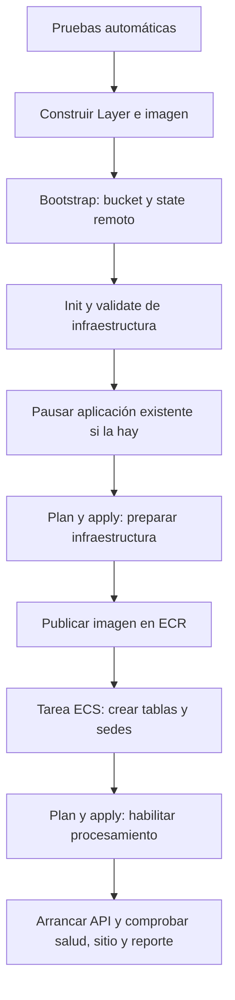

# Despliegue completo del TP3

## Qué hace

El workflow **desplegar-aplicacion** ejecuta `init`, `validate`, `plan` y `apply`, publica la imagen de la API, prepara la base y comprueba el resultado. Flask no crea tablas al arrancar: lo hace una tarea previa.

La tarea de inicialización usa la misma definición de ECS, imagen, subredes y permisos que la API, ejecuta `python manage_db.py upgrade` y termina. No agrega otro servicio permanente. AWS admite este uso de [tareas puntuales de ECS](https://docs.aws.amazon.com/AmazonECS/latest/developerguide/standalone-tasks.html).

## Cómo ejecutarlo

1. Guardar los cambios en un commit y subirlos al repositorio. Para habilitar por primera vez el workflow manual, incorporarlo a la rama predeterminada (`main`); luego se puede seleccionar otra rama al ejecutarlo. Es un requisito de [GitHub Actions](https://docs.github.com/en/actions/how-tos/manage-workflow-runs/manually-run-a-workflow).
2. Iniciar el Learner Lab. En el repositorio que ejecutará Actions, configurar los secrets `AWS_ACCESS_KEY_ID`, `AWS_SECRET_ACCESS_KEY` y `AWS_SESSION_TOKEN` vigentes.
3. Si ya hay un despliegue, configurar `TF_STATE_BUCKET` con **su mismo bucket de state**. Si se omite, se usa `accesoseguro-tfstate-<account_id>`. No cambiarlo para resolver un error: se perdería la referencia a la infraestructura existente.
4. Ir a **Actions → desplegar-aplicacion → Run workflow** y seleccionar la rama/commit de la entrega.
5. Abrir la URL que aparece al finalizar. Crear usuarios por Cognito; asignar los roles internos con `make grupo` (`scripts/asignar-rol.py`). Cada destinatario debe confirmar su suscripción SNS para recibir correos.

El script está configurado para este proyecto: `accesoseguro/dev`, región `us-east-1`. No requiere subir una imagen, ejecutar SQL o crear el bucket del state a mano. Sí requiere las credenciales y permisos del Lab; ningún repositorio puede generar esas credenciales por sí solo.

Equivalente local, con Python 3.12, Terraform >= 1.10, AWS CLI v2, Docker funcionando y un checkout limpio:

```bash
make deploy
```

`make plan` y `make apply` son operaciones individuales de Terraform. **No sustituyen el despliegue completo.** El script falla si hay cambios sin commit: el tag de la imagen debe identificar exactamente el código desplegado.

## Orden de ejecución



La actualización tiene una ventana de mantenimiento: se detiene la API y se pausa el procesamiento que necesita RDS. El consumidor de auditoría sigue activo, porque solo escribe en S3. Si falla la publicación de la imagen o la inicialización de la base, no se habilita la aplicación como si el despliegue hubiera terminado.

La imagen usa el SHA completo del commit como tag inmutable. Al repetir el mismo commit se reutiliza la imagen ya publicada. El workflow comprueba el código de salida de la tarea de inicialización, la revisión y cantidad de tareas de ECS, `/health`, el sitio y una invocación real de reportes. `/health` devuelve 503 si no puede acceder a la versión esperada del esquema.

## State, reejecución y fallos

El bootstrap comienza local solo cuando todavía no existe su bucket. Enseguida migra su state al mismo S3, bajo `accesoseguro/dev/bootstrap.tfstate`; la infraestructura usa `accesoseguro/dev/infra.tfstate`. Ambos usan cifrado y bloqueo nativo de S3. El workflow serializa las ejecuciones y no publica state, planes binarios ni URLs firmadas como artefactos. [Referencia del backend S3](https://developer.hashicorp.com/terraform/language/backend/s3).

`terraform/bootstrap/backend_override.tf` se genera para activar ese backend y está ignorado por Git. No se debe versionar el state ni borrar su bucket. Si existe un bootstrap manual local, ejecutar desde esa copia permite migrar su state; conservarlo como respaldo. Para un bucket existente sin state de bootstrap, el bootstrap configura de forma idempotente ese bucket mediante los recursos auxiliares que ya utiliza el proyecto.

Si falla un despliegue, revisar el paso que falló y, para una tarea ECS, su log en CloudWatch. Corregir la causa y ejecutar nuevamente el workflow. No borrar la infraestructura ni cambiar el bucket del state. Las tablas se crean de forma aditiva, bajo una transacción y un bloqueo de PostgreSQL; no se eliminan solicitudes ni se duplican sedes. Las futuras modificaciones del esquema deben incorporar una nueva migración/versionado en `backend/database_schema.py`.

## Qué sucede en un pull request

- `pruebas`: pruebas de Python, PostgreSQL 16, frontend y dependencias Linux de la Layer.
- `terraform`: `fmt`, `init`, `validate` y `plan` si el repositorio receptor tiene credenciales y el backend ya fue preparado.
- `desplegar-aplicacion`: ejecución manual de `init`, `validate`, `plan`, `apply` y puesta en marcha completa, después de las pruebas.

Los secrets no se transfieren a los PR de forks. En ese caso se informa explícitamente que no se ejecutó el plan; formato, validación y pruebas siguen ejecutándose. Para la evaluación completa, el repositorio receptor debe tener sus propios secrets y ejecutar primero **desplegar-aplicacion** para preparar el backend. Un PR no despliega automáticamente recursos en la cuenta.

## Documentos: funcionamiento real

1. La API comprueba que la solicitud pertenece al transportista y sigue pendiente. Registra el documento como **pendiente** y entrega una URL temporal para cargarlo.
2. El navegador carga el PDF directamente en S3. S3 avisa por la cola existente.
3. `validar-documento` lee **la versión exacta** del objeto, comprueba tipo declarado, tamaño mayor que cero y hasta el máximo configurado, y cabecera `%PDF-`.
4. Guarda **válido** o **rechazado**, el motivo y la versión en `documento_validacion`, relacionada por clave foránea con `solicitud`.
5. El responsable ve el resultado. Si hay un documento adjunto, no puede aprobar hasta que sea válido. El enlace abre la versión validada, incluso si luego se vuelve a escribir la misma clave en S3.

El adjunto es opcional. Esta validación es técnica y básica: no analiza malware, autenticidad ni contenido legal del PDF. El transportista puede reemplazar un archivo pendiente/rechazado desde **Mis solicitudes**.

Los eventos repetidos o atrasados no sobrescriben un resultado más reciente. Se compara el `sequencer` para la misma clave, como indica [S3](https://docs.aws.amazon.com/AmazonS3/latest/userguide/notification-content-structure.html). Si falla S3 o RDS, el mensaje se reintenta mediante la cola existente; solo se reportan los mensajes fallidos, según el mecanismo de [respuestas parciales de Lambda/SQS](https://docs.aws.amazon.com/lambda/latest/dg/services-sqs-errorhandling.html).

## Reportes: funcionamiento real

1. El responsable pide un reporte. La API verifica su identidad y toma la sede del perfil autorizado, no de un valor arbitrario del navegador.
2. Invoca `generar-reporte`, que consulta solicitudes e ingresos/egresos reales de esa sede en PostgreSQL. El filtro corresponde a la fecha de creación de la solicitud y el día final se incluye completo; las fechas almacenadas son UTC.
3. La Lambda genera el CSV y lo guarda en `reportes/` del bucket privado ya existente. Usa su cifrado y regla de eliminación al día.
4. Devuelve una URL firmada temporal. El navegador descarga con esa URL, sin enviar el token de Cognito a S3.

Sin registros, el CSV contiene únicamente encabezados. Se rechazan rangos inválidos y reportes de más de 10.000 filas, pidiendo acotar las fechas. Se escapan inicios de fórmulas en los campos de texto; es una mitigación de [CSV injection](https://community.owasp.org/attacks/CSV_Injection), no una garantía sobre posteriores transformaciones de la planilla.

Las cuatro Lambdas que acceden a RDS comparten una Layer. Contiene el driver PostgreSQL, SQLAlchemy, el código compartido y los certificados de RDS, con dependencias para Python 3.12 y Linux x86_64, siguiendo los requisitos de [AWS Lambda Layers](https://docs.aws.amazon.com/lambda/latest/dg/python-layers.html).

## Correspondencia con TP3

La consigna proporcionada exige módulos propios/externos, variables/outputs, al menos cuatro funciones y tres metaargumentos, un diagrama alineado, README y un pipeline que pueda ejecutar `init`, `validate`, `plan`, `apply` y que corra en el PR. Se conservan los módulos, funciones y metaargumentos documentados en el README. El pipeline incluye el despliegue completo. El diagrama actualizado está en el README y en `docs/arquitectura.mmd`.

Aunque la consigna permite datos simulados, las Lambdas de documentos, reportes, vencimientos y correos operan sobre RDS real.
